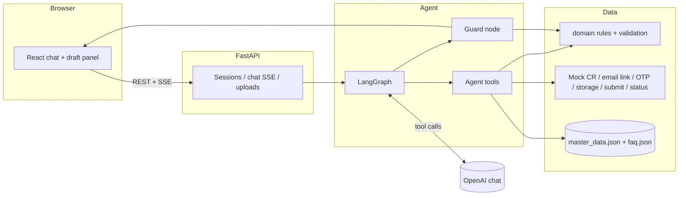

# Send Inquiry Agent (POC)

Chat replacement for the Cenomi Tenant Central **Send Inquiry** form: React + FastAPI + LangGraph + OpenAI, with mock Cenomi services for local demo.

## Quick start (~10 minutes)

**Prerequisites:** Docker Desktop (or Node 20 + Python 3.11+ with [uv](https://docs.astral.sh/uv/)), OpenAI API key for the live agent.

1. Clone and enter the repo.
2. Copy env and set your key:
   ```bash
   cp backend/.env.example backend/.env
   # Edit backend/.env: OPENAI_API_KEY, OPENAI_MODEL (e.g. gpt-4o-mini)
   ```
3. Start the demo stack:
   ```bash
   make demo
   ```
4. Open **http://localhost:5173**. The SMS code is **1234** (`OTP_MOCK_CODE`); the email link is a demo button in the verification card (`EMAIL_LINK_DEMO`).
5. Follow [docs/demo-script.md](docs/demo-script.md).

**Without Docker:**

```bash
# Terminal 1
make dev-backend

# Terminal 2
cd frontend && npm install && npm run dev
```

Set `VITE_API_BASE=http://localhost:8000` if the API is not on the default port.

**UI-only (no backend):** `cd frontend && VITE_MOCK=1 npm run dev`

## Commands

| Command | Purpose |
| --- | --- |
| `make demo` | Docker Compose with `OTP_MOCK_CODE=1234` and `VITE_DEMO=1` |
| `make dev` | Same stack without demo env defaults |
| `make dev-backend` / `make dev-frontend` | Run one app locally |
| `make ci` | Everything a PR needs, run locally: `check`, `test`, `e2e-int`. CI runs `make ci-remote` (`check`, `test`); Playwright runs on your machine |
| `make check` (`make lint`) | `check-be` (ruff, mypy) and `check-fe` (ESLint, `tsc`, Prettier) |
| `make test` | `test-be` (pytest) and `test-fe` (Vitest) |
| `make test-agent` | The deterministic agent tests on their own (scripted model) |
| `make e2e-int` (`make e2e`) | Playwright, real frontend + backend, scripted agent. Flags: `ARGS='-g "13 wrong files" --project=mobile'` |
| `make eval-live` | Live evaluation with the real model (needs `OPENAI_API_KEY`, `OPENAI_MODEL`) |
| `make e2e-live` | Playwright with the real model |
| `make gate` | Every layer: `ci`, `eval-live`, `e2e-live` (gates and demos) |

Test layers and when each must run: `docs/specs/testing-strategy.md`.

## Environment variables

| Variable | Where | Description |
| --- | --- | --- |
| `OPENAI_API_KEY` | backend | Required for agent |
| `OPENAI_MODEL` | backend | Chat model name |
| `OPENAI_TEMPERATURE` | backend | Default `0.6` (warmer, more varied replies) |
| `OTP_MOCK_CODE` | backend | Default `1234` |
| `EMAIL_LINK_DEMO` | backend | Default `true`: show the email-link demo button |
| `MAX_UPLOAD_MB` | backend | Default `5` |
| `UPLOAD_DIR` | backend | Local upload storage |
| `SESSION_TTL_MINUTES` | backend | Default `120` |
| `CORS_ORIGINS` | backend | Comma-separated frontend origins |
| `POLICY_PATH` | backend | Business-rule policy file; default `backend/app/policy/policy.yaml` |
| `MASTER_DATA_SOURCE` | backend | `seed` (default) or `cenomi` (stub) |
| `VITE_API_BASE` | frontend | API origin |
| `VITE_MOCK` | frontend | `1` = mock SSE, no backend |
| `VITE_DEMO` | frontend | `1` = show **Restart** in chat header |

See `backend/.env.example` and `frontend/.env.example` for the full list.

## Architecture



**Source of truth:** [docs/spec.md](docs/spec.md) · Design: [docs/design-spec.md](docs/design-spec.md) · Agent persona: [docs/agent-system-prompt.md](docs/agent-system-prompt.md)

## Swapping mocks for real Cenomi APIs

Implement the protocols in `backend/app/services/` (`CrService`, `EmailVerificationService`, `OtpService`, `StorageService`, `SubmitService`, `StatusService`) and wire implementations in `backend/app/services/container.py`. Routers and LangGraph tools depend on interfaces only — no agent changes required.

## Known limitations (POC)

- Sessions are in-memory (no cross-device resume).
- Document uploads check presence, extension, and size only — no content analysis.
- FAQ and mall master data are seeded placeholders.
- Live eval (`eval_live.py`) can vary run-to-run; CI uses scripted LLM scenarios.
- Lighthouse ≥ 95 is a manual check on the running demo page.

## Repo layout

| Path | Role |
| --- | --- |
| `frontend/` | Vite + React UI |
| `backend/` | FastAPI, agent, domain, mocks |
| `docs/` | Spec, design, demo script |
| `docs/specs/` | Fix specs (UI bugs, Playwright e2e) |
| `prompts/` | Step-by-step build prompts; current: `12-baseline-parity.md` (M0); see `docs/specs/README.md` |

Built with the Cursor prompt sequence in `prompts/`; step **11** covers polish, demo, and this README.
