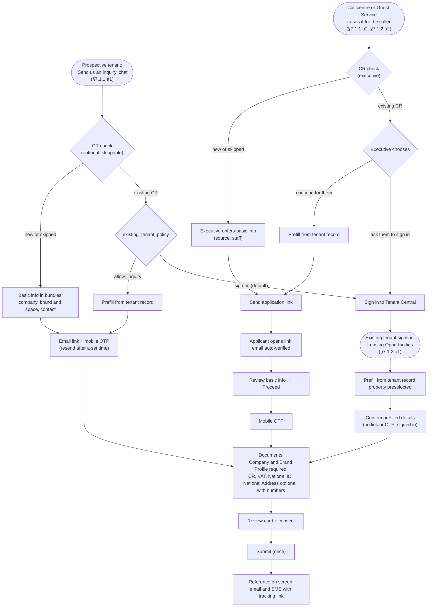
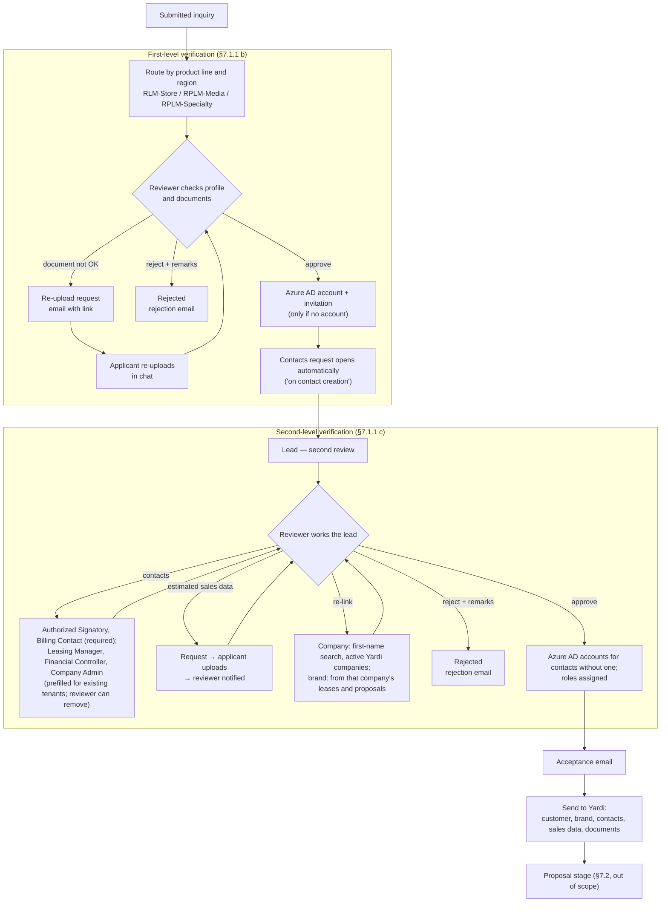
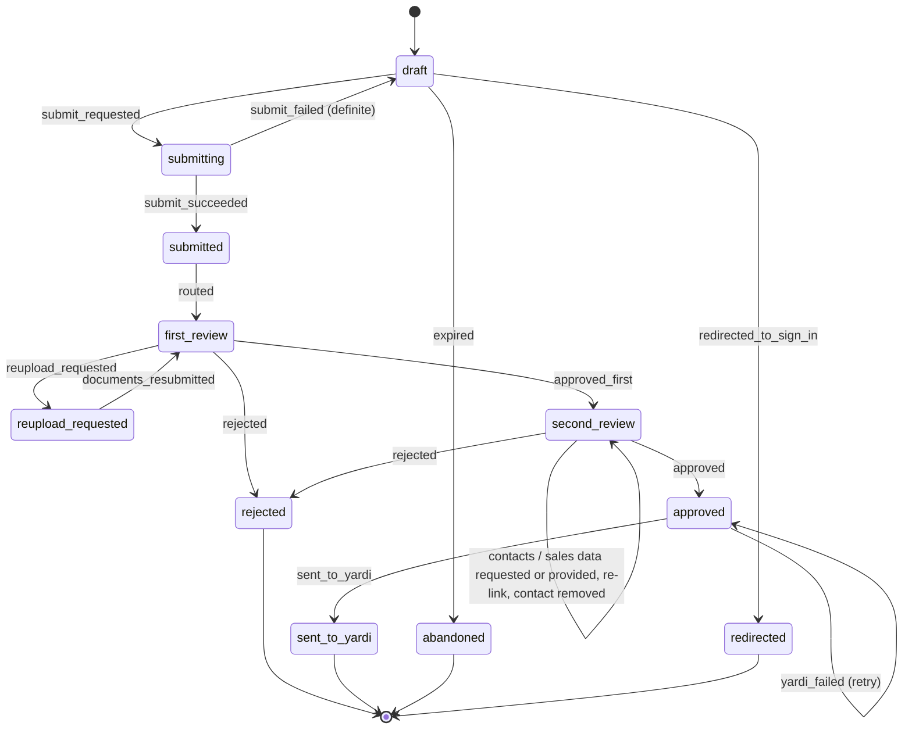

# POC lifecycle: the process, the agent, and what proves it

**26 Oct 2026.** One place that explains the whole inquiry-to-lead lifecycle the POC covers, and verifies it three ways: against the agent's design (who does what, what code enforces), against the maturity framework (L1–L5), and against the specs.

**Sources:** Cenomi Requirements Document v2.1.7.1 — §7.1, §7.1.1, §7.1.2 (process flows and both swimlane diagrams), the roles table, §6 phases, §7.12 Tenant Administration Platform, §7.14 Dashboard, §7.15 Notifications. Line-by-line coverage of §7.1 is in [`docs/specs/workflows-7-1.md`](specs/workflows-7-1.md); delivery order is in [`docs/DELIVERY-PLAN.md`](DELIVERY-PLAN.md).

**How to read the "When" column:** Built = on `main` today · Day N = the 5-day plan (27 Oct – 2 Nov) · S1 / S2 = Sprint 1 / Sprint 2 · Closing = 1–16 Dec.

---

## 1. Actors and systems

| Actor or system | Role in the requirements | POC stand-in |
| --- | --- | --- |
| Prospective tenant (primary contact) | Raises the inquiry, verifies email and mobile, uploads documents, answers reviewer requests | Applicant chat on the sign-in page; links to `/inquiry/verify`, `/inquiry/case`, `/inquiry/status` |
| Existing tenant | Raises inquiries from Leasing Opportunities after signing in; sees their inquiries | Tenant portal `/tenant` with a mock sign-in |
| Customer Relations Team (call centre) | "First level of contact … create and manage inbound tenant queries" (roles table); raises inquiries for callers (§7.1.1 a2, §7.1.2 a2) | Call-centre console `/callcentre`, intake agent in assisted mode |
| Guest Service (mall service desk) | "Will be able to add customer inquiries" (roles table) | Same console and assisted mode, role `guest_service` |
| RLM-Store, RPLM-Media, RPLM-Specialty | First- and second-level verification, by product line and region | Reviewer console `/review`, reviewer assistant |
| Super Admin | User management, invites existing tenants (§7.1, §7.12.1) | Out of scope |
| Tenant Platform / Tenant Admin Platform | Where tenants and Cenomi staff work | The chat, tenant portal and the two consoles |
| Azure AD | Creates tenant user accounts and sends invitations; roles assigned on approval (§7.12.1–7.12.2) | `IdentityService` mock |
| Yardi | Source of active companies and brands; receives the approved lead (§7.1.1 c) | `YardiService` mock |
| Email and SMS | Verification, tracking, requests, outcomes (§7.15) | `NotificationService` mock with a dev inbox |

---

## 2. The lifecycle at a glance

### 2.1 From first contact to a submitted inquiry

### 2.2 From submitted inquiry to a Yardi-ready lead

### 2.3 Case states (the workflow state machine, M0 §6)

Inside `draft`, the intake phase (gate → collecting → verifying → documents → review) is computed from the draft by `compute_phase`, as today. `awaiting_applicant` (assisted inquiries waiting for the link to be opened) is a draft sub-state.

---

## 3. The lifecycle stage by stage

Each stage lists what the requirements ask for, what deterministic code does, what the agent does, and where it's specified and built. Deterministic code owns every rule and state change; the agent explains, extracts, prepares and asks (golden rules 1–3).

### 3.1 Entry: who starts the inquiry

| Channel | Requirement | System (code) | Agent | Spec | When |
| --- | --- | --- | --- | --- | --- |
| Self-service, prospective | §7.1.1 a1 | Session, welcome, `route_message()` | Intake agent; routes status, General Inquiry, existing-tenant and off-topic messages; offers a person | L3 §3.5 | Built; router Day 3 |
| Call centre or Guest Service | §7.1.1 a2, §7.1.2 a2; roles table | Staff sign-in, `channel: assisted`, `staff` source | Intake agent in assisted mode: talks to the executive about "the caller" | Channels §3.2 | Day 5 |
| Existing tenant, signed in | §7.1.2 a1 | Tenant sign-in, opportunities, prefill, preselected property | Intake agent in existing-tenant mode: greets by name, asks only what's missing | Channels §3.4–3.5 | Day 5 |
| Existing CR on the public page | §7.1 | `existing_tenant_policy` | Explains and offers sign-in, or continues with prefill | Channels §3.6 | Days 1, 5 |

### 3.2 Intake: basic info

| Requirement | System (code) | Agent | Spec | When |
| --- | --- | --- | --- | --- |
| CR check, optional and skippable | `verify_cr`; CR prefill as `verified` | Asks once, explains what a CR is, offers to skip | `docs/spec.md` §3 | Built |
| 12 fields (names, company, address, brand EN and AR, sales category, product line, one mall, mobile and/or landline, email) | Validators, `can_submit`, policy file | Three bundled questions; extracts many fields per message; derives Arabic name, unit type and category; confirms by summary | `docs/spec.md` §2; L3 §3.7 | Built; policy Day 1 |
| Derived and prefilled values are confirmed before submit | `confirm_fields` only for values already shown on a card; `staff` values need Proceed | Moves on when the user carries on; holds a value when they hesitate (English and Arabic) | Pre-baseline F1; Channels §3.1; L3 §3.10 | Day 1; Day 3 |
| Arabic users | Arabic-Indic digits normalised before every rule | Replies in Arabic | L3 §3.10 | Day 3 |

### 3.3 Verification

| Requirement | System (code) | Agent | Spec | When |
| --- | --- | --- | --- | --- |
| Email verified by link; the click verifies it | Signed single-use token; `/inquiry/verify` | Points to the inbox in one sentence; moves on when verified | L3 §3.2 | Day 2 |
| Mobile (if given) verified by OTP; resend after a set time | OTP mock; cooldown and hourly cap; code never reaches the model | Points to the code box; explains a wait | L3 §3.3 | Built; cooldown Day 2 |
| Complete the application from the link, on any device | Resume endpoint rebuilds the chat | Continues where they left off | L3 §3.2 | Day 2 |
| Signed-in existing tenants | Verification taken from the session | — | Channels §3.5 | Day 5 |

### 3.4 Documents

| Requirement | System (code) | Agent | Spec | When |
| --- | --- | --- | --- | --- |
| Company Profile and Brand Profile required; CR, VAT, National ID, National Address optional | Presence, type and size only; no content read | Says which are required, mentions optional ones once | `docs/spec.md` §2 | Built |
| CR ID shown read-only; VAT ID, National ID, National Address entered with their documents | `numbers[]` on the card, existing validators | — | Pre-baseline F5 | Day 1 |
| Moving on when the required documents are in | `documents_updated` runs a turn; review card appears | One-line thanks and pointer | Pre-baseline F2 | Day 1 |
| Existing tenants: documents on file | Referenced from the tenant record; keep or replace | Offers them | Channels §3.4 | Day 5 |

### 3.5 Review, consent, submit

| Requirement | System (code) | Agent | Spec | When |
| --- | --- | --- | --- | --- |
| Review all details; consent | Review card; `terms_accepted` set only by the UI action | Points to the card; can't consent or submit | `docs/spec.md` §4 | Built |
| One reference per inquiry | Submit once (Day 2); idempotency key and reconciliation (S1) | Never claims success without the reference (guard) | M0 §7.2 | Day 2; S1 |
| Reference on screen, sent by email and SMS with a tracking link | Notifications; `track` token | Shares the reference warmly | L3 §3.4 | Day 2 |
| Possible duplicate | Checked after verification | Tells the applicant; never reveals another applicant's details | L3 §3.12 | S1 |

### 3.6 Routing to the reviewer

| Requirement | System (code) | Agent | Spec | When |
| --- | --- | --- | --- | --- |
| Store → RLM-Store, Media → RPLM-Media, Specialty → RPLM-Specialty, by region | `submitted` effect `routed(queue)`; policy `review_routing`; mall → region | — | L4 §3.2 | Day 4 |
| Only that queue's reviewers can act | Actor check in the state machine | — | M0 §6 | Day 4 |

### 3.7 First-level verification (RLM / RPLM)

| Requirement | System (code) | Agent | Spec | When |
| --- | --- | --- | --- | --- |
| Reviewer verifies the customer profile and documents | Queue and case page; documents viewable; only legal actions shown | **Reviewer assistant:** grounded case brief (every value's source and evidence, verification checks, documents, related or duplicate inquiries, what's missing) | L4 §3.3, §3.6 | Day 4; assistant Day 5 |
| A document isn't acceptable → re-upload request | `reupload_requested(doc_types, remarks)`; `reupload_request` email with a case link | Reviewer assistant drafts the remarks. **Case assistant:** explains which document and why, shows only those uploads; Resubmit returns the case to review | L4 §3.5 | Day 4 |
| Background checks → reject with remarks | `rejected(remarks, category)`; rejection email | Case assistant explains the remarks plainly and what the applicant can do next; never reopens | L4 §3.4–3.5 | Day 4 |
| Approve → Azure AD account and invitation | `approved_first`: invite unless the contact has an account | Case assistant explains the invitation | L4 §3.4 | Day 4 |
| "On contact creation, a notification … to provide additional tenant contacts" | System contacts request opens automatically | Case assistant collects contacts (3.8) | L4 §3.4 | Day 4 |
| The tenant is then a **lead** for second-level verification | Status "Lead — second review" | Uses the same word | L4 §3.8 | Day 5 |

### 3.8 Second-level verification (RLM / RPLM)

| Requirement | System (code) | Agent | Spec | When |
| --- | --- | --- | --- | --- |
| Additional contacts: Authorized Signatory and Billing Contact required; Leasing Manager, Financial Controller, Company Admin optional | Contacts request; policy `second_level_contacts`; validators | **Case assistant:** one bundle question; "that's me" reuses the primary contact (confirmed) | L4 §3.5 | Day 4 |
| Existing tenants: contacts prefilled, reviewer can delete | Prefill from the tenant record; `contact_removed` | Shows prefilled contacts for confirmation | Channels §3.7 | Day 5 |
| Estimated sales data: request → upload → reviewer notified | `sales_data_requested` / `provided`; both notifications | Explains the request, takes the upload | L4 §3.4–3.5 | Day 4 |
| Re-link company and brand from Yardi | `company_relinked`, `brand_relinked`, checked against Yardi | **Reviewer assistant:** suggests matches with the reason (first-word rule, active companies; brands from the company's leases and proposals); **Use** fills the form, never submits | L4 §3.3, §3.6 | Day 5 |
| Approve or reject the lead | Console actions; contacts required before approval (policy) | Reviewer assistant declines to decide: points to the button | L4 §3.3 | Days 4–5 |
| Approve → Azure AD accounts for contacts without one, roles assigned | `has_account` check; invite with the contact's role | Case assistant explains | L4 §3.4 | Day 5 |

### 3.9 Handover to Yardi

| Requirement | System (code) | Agent | Spec | When |
| --- | --- | --- | --- | --- |
| Acceptance email to the primary contact | `inquiry_accepted` | Explains the Proposal stage comes next | L4 §3.4 | Day 5 |
| Customer, brand, contacts, sales data and documents sent to Yardi | `send_lead(LeadPayload)`, idempotent; retries; operations flag after repeated failure | Never says "sent" before Yardi acknowledges (guard) | L4 §3.7 | Day 5; retries S2 |

### 3.10 Tracking and notifications throughout

**Tracking.** The private tracking page and the case assistant both show the stage, the owner as a role, the last change and anything waiting on the applicant (L3 §3.4, L4 §3.8). Existing tenants also see every inquiry in My inquiries.

**Notifications** (§7.15: "information" or "action required"). All go to the dev inbox in the POC.

| Trigger | Recipient | Kind | Template | When |
| --- | --- | --- | --- | --- |
| Email verification | Applicant | Action required | `email_verification_link` | Day 2 |
| Mobile code | Applicant | Action required | `sms_otp` | Day 2 |
| Continue later | Applicant | Action required | `resume_link` | S1 |
| Executive sends the application | Applicant | Action required | `complete_application` | Day 5 |
| Submitted | Applicant (email and SMS) | Information | `submission_email`, `submission_sms` | Day 2 |
| Routed | Queue reviewers | Information | `review_assigned` | Day 4 |
| Re-upload requested | Applicant | Action required | `reupload_request` | Day 4 |
| Re-upload received | Queue reviewers | Information | `reupload_received` | Day 4 |
| Rejected (either level) | Applicant | Information | `inquiry_rejected` | Day 4 |
| First-level approval | Applicant | Information | `first_level_approved` | Day 4 |
| Azure AD invitation | New users | Action required | `azure_ad_invitation` | Day 4 |
| Contacts requested (automatic or by reviewer) | Applicant | Action required | `contacts_request` | Day 4 |
| Contacts received | Queue reviewers | Information | `contacts_received` | Day 4 |
| Sales data requested | Applicant | Action required | `sales_data_request` | Day 4 |
| Sales data received | Queue reviewers | Information | `sales_data_received` | Day 4 |
| Request withdrawn | Applicant | Information | `request_withdrawn` | Day 4 |
| Approved | Applicant | Information | `inquiry_accepted` | Day 5 |
| Stalled review, reminders, escalations | Reviewers or applicant | Per policy tier | L5 templates | Day 5 (resume nudges: Closing) |

### 3.11 Exceptions and recovery

| Situation | System (code) | Agent | Spec | When |
| --- | --- | --- | --- | --- |
| The applicant asks for a person, or the agent can't finish | Handoff card; call-centre case that continues the same inquiry | Offers it; never invents contact details | L3 §3.6; Channels §3.2 | Day 3; Day 5 |
| A Cenomi system times out or is down | Gateway timeouts, retries, typed errors; inquiry stays resumable | Says what happens next | M0 §7; L3 §3.1 | Faults Day 2; gateway S1 |
| Submit times out | `submit_pending`; reconcile before retrying | Says it's being confirmed; never claims success | M0 §7.2 | Day 3 story S3; S1 |
| **The model itself is unavailable** | Form mode: the inquiry can be finished from the draft panel, cards and review card without the model; handoff offered | — | L3 §3.14 | Day 3; hardened S1 |
| Expired or used link | Clear error; offer to resend | — | L3 §3.2 | Day 2 |
| Second mall | Follow-on inquiry reusing verified details | Asks only for the new mall | L3 §3.11 | Day 3 |
| Stalled review, unanswered request (abandoned draft later) | Proactive triggers under the notification policy | Drafts reminders for approval | L5 | Day 5; Closing |

---

## 4. Verification against the maturity framework (L1–L5)

The framework assigns maturity per workflow and capability. Here it is for the inquiry-to-lead workflow, with where each capability lives in the lifecycle above.

### 4.1 L1 and L2 baselines

| Level | Framework acceptance evidence | POC | When |
| --- | --- | --- | --- |
| L1 | The task can be completed through a reliable digital form | Cards and the review card hold every field; **form mode lets the user finish without the model** (§3.11) | Built; form mode Day 3, hardened S1 |
| L1 | Forms satisfy schema, accessibility, authorisation, persistence and duplicate-submission controls | Validators; axe in frontend Playwright; mock identities per console; Postgres store; idempotent submit | Built; S1 |
| L2 | All form paths work conversationally with no field loss | Every field reachable by chat, card or edit; parity goldens | Built; goldens S1 |
| L2 | Clear handoff to the original transaction | Handoff to the call centre, continuing the same inquiry | Day 3; Day 5 |

### 4.2 L3 — intent-aware task execution

| # | Capability | Where in the lifecycle | When |
| --- | --- | --- | --- |
| 1 | Intent detection and routing | §3.1 router; supervisor | Day 3; S1 |
| 2 | Multi-field extraction with provenance | §3.2 bundles; evidence for derived values | Built; evidence Day 3 |
| 3 | Entity resolution | §3.2 malls, categories, Arabic names; §3.8 Yardi companies and brands | Built; Days 1, 5 |
| 4 | Verified context reuse | §3.2 CR prefill; §3.1 tenant-record prefill; follow-on inquiries | Built; Days 3, 5 |
| 5 | Adaptive slot filling | §3.2 bundles; §3.4 documents-complete turn | Built; Day 1 |
| 6 | Deterministic validation | §3.2–3.5 validators, policy file, confirm-only-shown, `staff` confirmation | Built; Days 1, 5 |
| 7 | Durable drafts and resume | §3.3 resume from the link; survives a restart (snapshot, then Postgres) | Day 2; S1 |
| 8 | Explicit review and consent | §3.5 | Built |
| 9 | Reliable tool and API execution | §3.5 submit once; §3.11 timeouts and typed failures (thin gateway, then retries and reconciliation) | Day 2; S1 |
| 10 | Audit and recovery | §3.11 handoff, form mode, faults; audit log v0 with the console timeline | Days 2–4; S1 |

### 4.3 L4 — context-aware outcome ownership

| # | Capability | Where in the lifecycle | When |
| --- | --- | --- | --- |
| 1 | Outcome framing | §3.7–3.9 case assistant: stage, owner, next step | Day 4 |
| 2 | Structured context assembly | §3.7 grounded case brief | Day 4 |
| 3 | Grounded derivation and prefill | Evidence; tenant-record prefill; "that's me" contact reuse | Days 4–5; S1 |
| 4 | Adaptive dialogue | §3.8 one contacts bundle; re-upload asks only for what's requested | Day 4 |
| 5 | Bounded read-and-reason tools | Case and reviewer tool allowlists | Days 4–5 |
| 6 | Cross-step continuity | Executive → applicant handover; case links reopen the same case; no intake questions after submit | Days 4–5 |
| 7 | Reviewer assistance | §3.7–3.8 brief, Yardi suggestions, drafted remarks | Day 5 |
| 8 | Exception and rework reduction | Targeted re-upload; duplicate check; automatic contacts request | Day 4; S1 |
| 9 | Human collaboration (reviewers decide) | Actor checks; assistant never decides; suggestions audited | Days 4–5; S2 |
| 10 | Outcome tracking | §3.10 tracking page, case assistant, My inquiries | Days 2, 5 |

### 4.4 L5 — governed proactivity

| # | Capability | Where | When |
| --- | --- | --- | --- |
| 1 | Event and state awareness | Triggers on each clock tick (case states, then the audit stream) | Day 5; Closing |
| 2 | Next-best-action recommendations | "Needs attention" ranking | Day 5 |
| 3 | Proactive preparation | Reminders drafted by the reviewer assistant (deterministic checks later) | Day 5; Closing |
| 4 | Cross-role coordination | Escalation to the region manager | Day 5 |
| 5 | Process optimisation | Raised / sent / dismissed counts; funnel; insight report | Day 5; S2; Closing |
| 6 | Bounded automation | Notification tiers | Day 5 |
| 7 | Attention management | Quiet hours and once per period; throttles and opt-out | Day 5; Closing |
| 8 | Feedback and learning | Accepted vs dismissed per item; KPI comparison on and off | Day 5; Closing |

**Verdict.** Every framework capability L1–L5 has a home in the lifecycle and a step that builds it. The one missing piece was the L1 baseline itself — finishing the inquiry when the model is down — now added as form mode (§3.11).

---

## 5. Verification against the specs

| Spec | Lifecycle stages it owns | Check | Result |
| --- | --- | --- | --- |
| [pre-baseline-fixes.md](specs/pre-baseline-fixes.md) | 3.2, 3.4 | Confirm-only-shown, documents turn, Office, document numbers | ✅ Consistent |
| [testing-strategy.md](specs/testing-strategy.md) | All | Every stage has scripted stories; live stories cover the agent's judgement | ✅ Stories S1–S13, T1–T10, P1–P6 |
| [m0-modular-core.md](specs/m0-modular-core.md) | 2.3, 3.5, 3.11 | State machine has every transition in §2.3 | **Fixed:** no state for "ask them to sign in" — added `redirected` and its event |
| [l3-reliable-intake.md](specs/l3-reliable-intake.md) | 3.1–3.5, 3.10–3.11 | Intake, verification, tracking, recovery | **Fixed:** no fallback when the model is down — added §3.14 form mode and story S13 |
| [intake-channels.md](specs/intake-channels.md) | 3.1, 3.8 | All four ways in | **Fixed:** Guest Service desk (roles table) added as a second staff role |
| [l4-outcome-assistance.md](specs/l4-outcome-assistance.md) | 3.6–3.10 | Routing, both review levels, Yardi | **Fixed:** Azure AD invitations now carry the contact's role (§7.12.2); console gains a funnel and pending-approvals view (§7.14, Should) |
| [l5-governed-proactivity.md](specs/l5-governed-proactivity.md) | 3.11 (proactive) | Triggers cover stalled reviews and unanswered requests, including the automatic contacts request | ✅ Consistent |
| [workflows-7-1.md](specs/workflows-7-1.md) | All | R1–R81 against §7.1 | ✅; now also lists the other sections that touch the inquiry |

---

## 6. What this review found

| # | Finding | Source | Decision | Where | When |
| --- | --- | --- | --- | --- | --- |
| G1 | No way to finish the inquiry if the model is down (L1 baseline) | Framework §3, §10 | Form mode | L3 §3.14; step 21 | Day 3; hardened S1 |
| G2 | Guest Service desk can also add inquiries | Roles table | Second staff role in the assisted channel | Channels §3.2 | Day 5 |
| G3 | "Ask them to sign in" had no workflow state | M0 §6 vs Channels §3.2 | `redirected` status | M0 §5.1, §6; step 14 | Day 5 (in memory); S1 |
| G4 | Approved contacts are assigned their tenant roles | §7.12.2 | `IdentityService.invite(contact, role)` | L4 §3.2; step 23 | Day 4 |
| G5 | Super Admin dashboard: funnel (lease request → lead), pending approvals | §7.14 | Funnel view in the console (Should) | L4 §3.3; step 24 | S2 |
| G6 | The demo needs to switch between five personas and reset | Delivery | `/dev` landing page with every entry point; reset of the mock world | Delivery plan Day 5 | Day 5 |
| G7 | Notification wording and triggers live in a document the requirements link to but we don't have | §7.15 "Please refer – Link" | Templates stay synthetic; ask Cenomi | §7 below | — |
| G8 | UX wireframes and UI designs are linked but not provided | Requirements "Concept Mocks" | New pages follow `docs/design-spec.md`; ask Cenomi | §7 below | — |
| G9 | Lead verification by "Cenomi Leasing Staff" as well as RLM/RPLM (§6 phases); Regional Sales Manager replaced Key Account Manager for inquiries (revision V1.7) | §6; revision history | Not built; ask whether another role takes part | §7 below | — |

**Considered and left out:** re-inviting users who haven't logged in (Super Admin, §7.12.1), messaging between tenant and staff (§7.13 covers proposals, service requests and sales data, not inquiries), and the tenant dashboards beyond My inquiries (§7.14).

## 7. Questions to send Cenomi with this review

1. The §7.1 flow diagrams as source files or high-resolution images (the embedded ones can't be read).
2. The notification content and trigger document referenced in §7.15.
3. The UX wireframes and UI designs referenced in the requirements.
4. Does anyone besides RLM-Store / RPLM-Media / RPLM-Specialty take part in lead verification ("Cenomi Leasing Staff" in §6; Regional Sales Manager in revision V1.7)?
5. Existing-tenant policy on the public page (§7.1 vs §7.1.1 a2), and the assumptions in each spec (`docs/STATUS.md` §5).
6. Is the UI expected in Arabic (right-to-left) for the POC, or is the agent replying in Arabic enough (today's assumption)?
